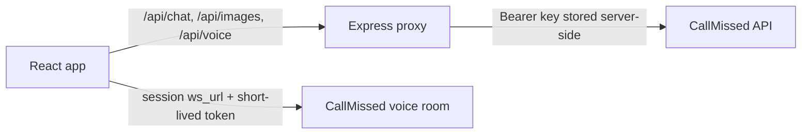

# CallMissed Studio

A responsive workspace for the CallMissed take-home: chat, image generation, and a live voice agent in one interface.

## Features

- Chat with selectable models, Markdown/code rendering, retry, and conversation controls.
- Generate one image per request, browse the session gallery, preview, and download results.
- Start a browser voice session with live transcripts, microphone mute, and reliable disconnect cleanup.
- Dark/light themes, mobile navigation, keyboard shortcuts, focus handling, and reduced-motion support.
- Same-origin Express proxy keeps the CallMissed API key on the server.

## Stack and architecture

React 18, TypeScript, Vite, Express, LiveKit WebRTC client, Vitest, MSW, Testing Library, and Playwright.



Only CallMissed provides AI services. LiveKit's client library carries the voice session transport specified by CallMissed. No third-party AI or search APIs are used. The browser never receives the CallMissed API key.

## Run locally

1. Create a CallMissed key with `llm`, `image`, `stt`, and `tts` permissions. Set its budget cap to **$20 or less** in the CallMissed console.
2. Copy `.env.example` to `.env` and set `CALLMISSED_API_KEY` in `.env`. Keep `.env` private; it is ignored by Git.
3. Install and start:

   ```sh
   npm ci
   npm run dev
   ```

4. Open `http://localhost:5173`. The Vite server proxies `/api/*` to the Express server at `PORT` (3756 in the provided local env example; 3000 if unset).
5. For a production build, run `npm run build && npm start`, then open the configured `PORT` (default 3000).

The status dot only reports whether the local server has a key configured. It does not validate the key with a paid service call.

## Budget safeguards

- Chat requests are capped at 700 output tokens and locally limited to 20 requests per IP per minute.
- Image requests are fixed to one 1024×1024 image and locally limited to 3 requests per IP per hour.
- Voice sessions have a three-minute maximum and are locally limited to 3 starts per IP per hour. The client does not retry voice session creation.
- Upstream request timeouts, request size/prompt limits, and retries with idempotency keys for chat/images help avoid runaway or duplicate calls.
- The local rate limiter is in memory and resets when the server restarts. It is suitable for the single-instance demo deployment; a scaled multi-instance deployment should use a shared limiter.

Keep the CallMissed key's own budget cap at $20 or lower. These safeguards reduce accidental usage but cannot guarantee a hard total spend cap if the key is shared or used outside this app.

## Verification

All automated API responses are mocked. Running the checks does not call CallMissed or spend credits.

```sh
npm run lint
npm run format:check
npm run typecheck
npm test
npm run test:coverage
npm run build
npm run test:e2e
```

The E2E suite routes every `/api/*` request to local Playwright mocks. To run it, install the browser once with `npx playwright install chromium`.

## Deploy to Render

The repository includes `render.yaml` for a Node web service. Create a Render Blueprint from the repository, then set `CALLMISSED_API_KEY` in the service's private environment settings. The config builds the static client and serves it from Express; `/api/status` is the health check. Keep the key out of GitHub Actions, client-side `VITE_*` variables, and committed files.

## Deploy to Vercel

Vercel serves the Vite client from `dist` and runs the API routes in `api/` as serverless functions. Set `CALLMISSED_API_KEY` in the Vercel project's Environment Variables for Production (and Preview if needed), then redeploy. Check `https://your-deployment.vercel.app/api/status`; it should return `{"configured":true}` without exposing the key.

## Known limits

- Chat and image history live in the current browser session and are not persisted to an account.
- The voice transcript is live in the page; post-call transcript retrieval is not implemented.
- Per-IP rate limiting is process-local; use a shared store before running multiple server instances.
